## Azure Fundamentals capstone project.
## Project Overview

This project demonstrates how to build and secure cloud infrastructure on Microsoft Azure using network security controls, secure virtual machine administration, private connectivity, and identity-based access to cloud storage.

The implementation involved provisioning and configuring an Ubuntu virtual machine, establishing secure administrative connectivity through Azure Bastion, and working with Virtual Networks (VNets), subnets, and Network Security Groups (NSGs) to control network traffic. The project also secured Azure Blob Storage using a Private Endpoint, Private DNS, and a system-assigned managed identity.

Public network access to the storage account was disabled to reduce exposure through its public endpoint. The virtual machine successfully resolved the storage account hostname to the private endpoint IP address (`10.0.2.5`) and used its managed identity to list and download a stored file without relying on hard-coded storage credentials.

### Why Security Matters

Cloud security is essential because misconfigured network rules, unnecessarily exposed management ports, excessive permissions, and poorly protected credentials can increase the risk of unauthorized access and data exposure.

This project applies a layered security approach:

- **Secure administration:** Azure Bastion provides a way to connect to virtual machines without requiring direct inbound SSH access through a public IP on the VM, when configured appropriately.
- **Network security:** VNets, subnets, and NSGs help isolate resources and control permitted network traffic.
- **Private connectivity:** Azure Private Endpoint and Private DNS enable private network access to Blob Storage.
- **Identity-based authentication:** A system-assigned managed identity allows the VM to authenticate to Azure services without storing long-lived credentials in scripts.
- **Access control:** Azure role-based access control (RBAC) determines which resources and storage operations an identity is authorized to access.
- **Reduced public exposure:** Disabling public network access on the storage account prevents access through its public network endpoint.

Together, these controls demonstrate the principle of **defense in depth**: combining network restrictions, secure administration, authentication, and authorization rather than relying on a single security mechanism.

### Project Outcomes

- Configured an Azure Ubuntu virtual machine and administrative access through Azure Bastion.
- Worked with Azure networking components, including VNets, subnets, and NSGs.
- Configured private connectivity to Azure Blob Storage using a Private Endpoint and Private DNS.
- Enabled and used system-assigned managed identity authentication for storage access.
- Confirmed that the VM could list and download the `image.PNG` blob from the `uploads` container.
- Verified in the Azure Portal that public network access to the storage account was disabled.

**Validation note:** An external `curl` request returned HTTP 400, which did not conclusively demonstrate that an external connection was denied. The storage account configuration and successful private access were verified; independent external denial testing remains outstanding.

## IMPLEMENTATION OF PROJECT

### Create a Resource Group

1. Click on create
2. Set the resource group name as Nimbus-lab
3. Choose the region
4. Select   Review + create,Then create
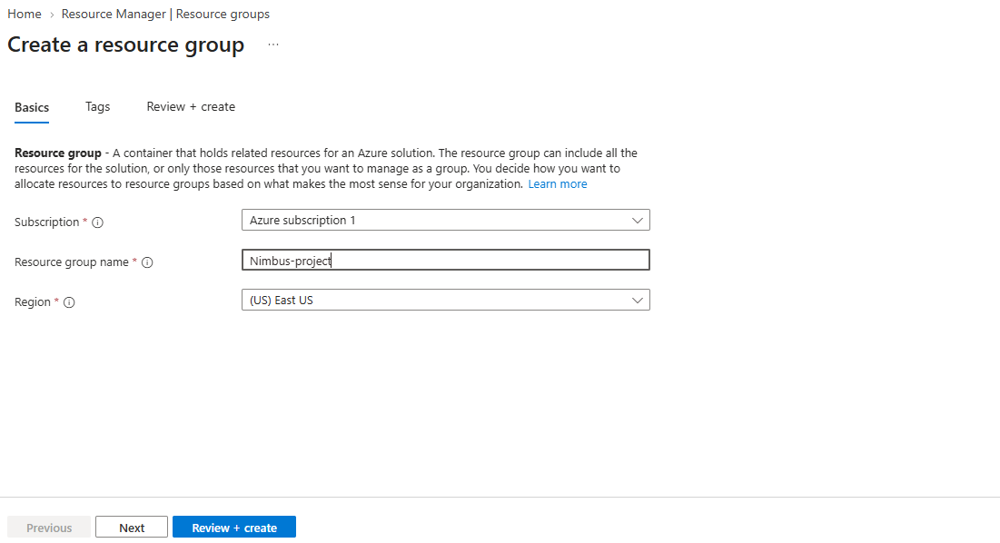

### Phase 2: Create hub Vnet 

1. Search for Virtual network, then select Create.

2. On Basics, select the subscription, resource group nimbus-labs, VNet name nimbus-hub-vnet, and your chosen region.

3. Under IP addresses, set the address space to 10.0.0.0/16.

4. Create a subnet named nimbus-hub-subnet with address range 10.0.1.0/24.
Review the settings and select Create.
   
   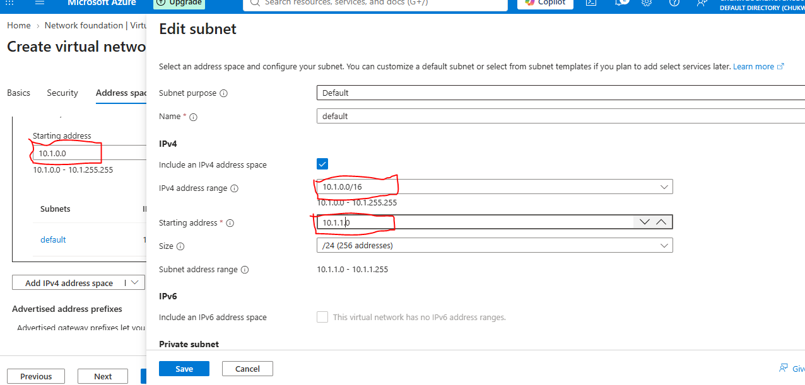
   Repeat same for the second Vnet with a address space 
   ```
   10.1.0.0/16
   ```
   and subnet range
   ```
   10.1.1.0/24
   ```

   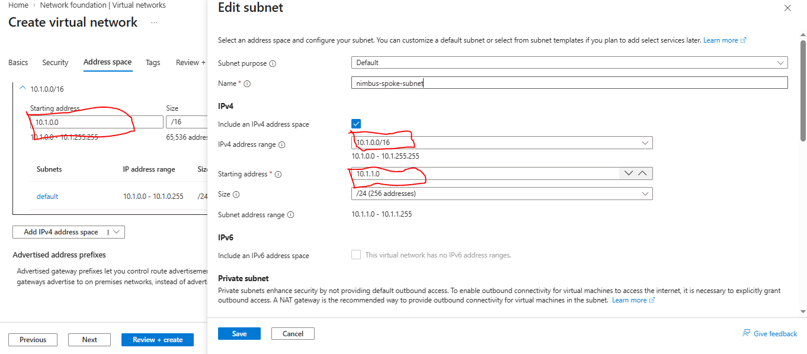

   ### Phase 4 — Deploy three Linux VMs

   Create three Linux virtual machines. The exact portal labels may vary slightly.

For each VM:
1. Search for Virtual machines and select Create → Azure virtual machine.
2. Select resource group nimbus-labs and your chosen region.
3. Choose an available Ubuntu LTS image or another supported Linux distribution.
4. Use a suitable low-cost VM size available in your region.
5. Choose SSH public key authentication and configure an administrator username.
6. Under Networking, attach the VM to the correct VNet and subnet.
7. Review inbound port rules. Do not open SSH to Any / 0.0.0.0/0; restrict access to a trusted source or use a managed access option.
8. Review and create the VM.
9. Wait for deployment to complete, then verify the VM's networking configuration.

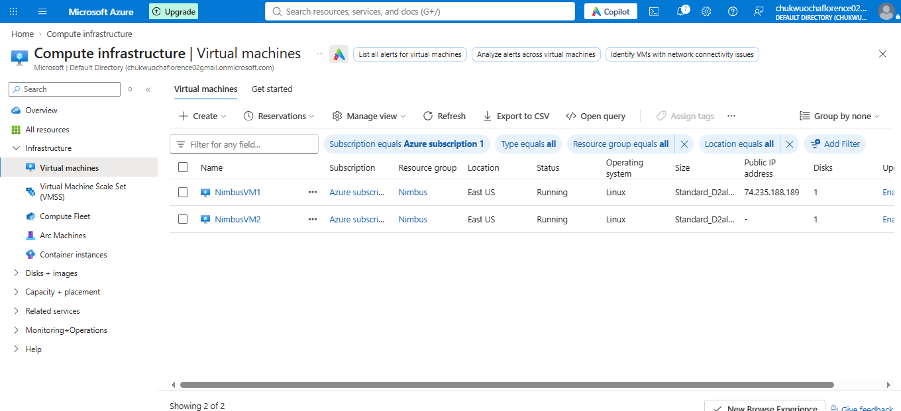

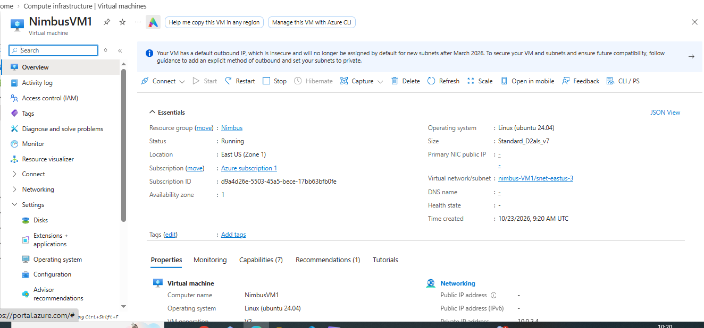

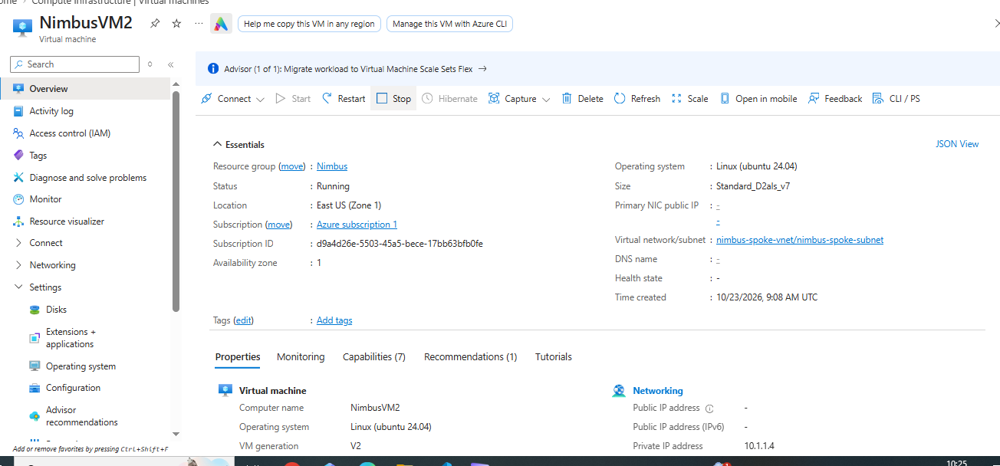


### Phase 5  Configure VNet peering
Peering is required if you want the hub and spoke VMs to communicate using their private IP addresses.
1. Open nimbus-VM1.
2. Navigate to Peerings and select Add.
3. Give the hub-side peering a clear name, such as hub-to-spoke.
4. Select nimbus-spoke-vnet as the remote VNet.
5. Enable VNet access in both directions where the portal offers the setting.
6. Create the peering.
7. If a reverse peering was not created automatically, open nimbus-spoke-vnet → Peerings → Add and create spoke-to-hub, pointing to nimbus-hub-vnet.
8. Confirm both peering links show Connected.
Portal wording can vary. Do not enable gateway transit or remote gateway options unless you have a gateway design that requires them.

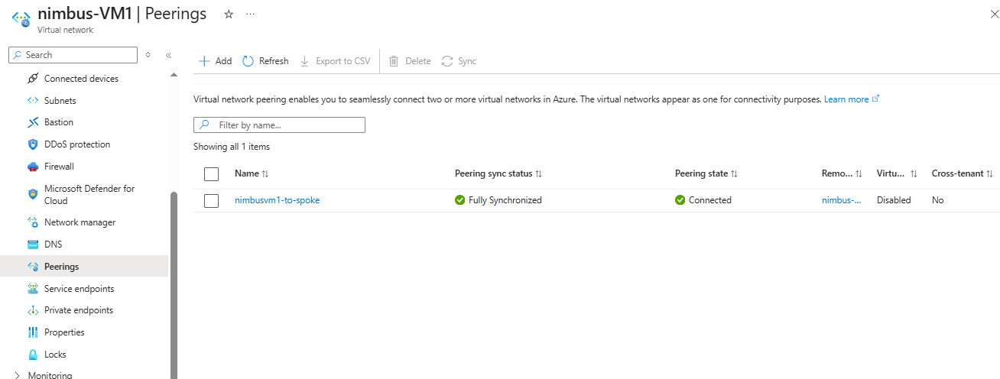

### Phase 6 Configure Bastion

   1. Search for Bation on the search engine and Click create
   2. Choose a Resource type
   3. Select a region
   4. Give it a name "Bastion"
   5. Select The virtual network "nimbus-VM1"
   6. Choose the subnet " AzureBastionSubnet"
   7. Click on Review + create
   
   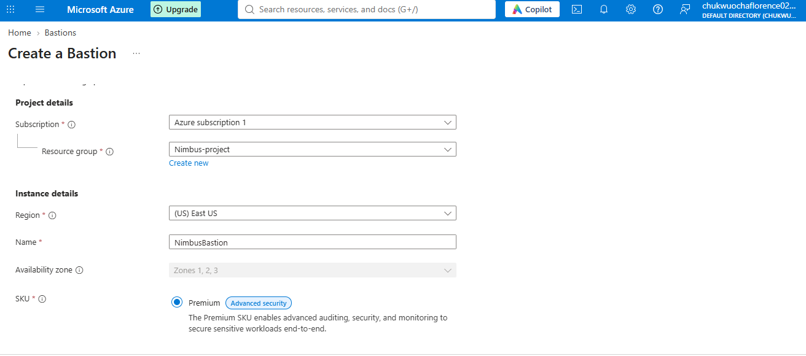

### Phase 7 Connect Bastion to The Virtual Machine

1. Navigate to the Virtual machine that has AzureBastionSubnet as its Name.
2. Click on the Connect icon on the top left
3. Select connect to Bastion
4. Inpute the Username and Password 
5. Then click the connect botton
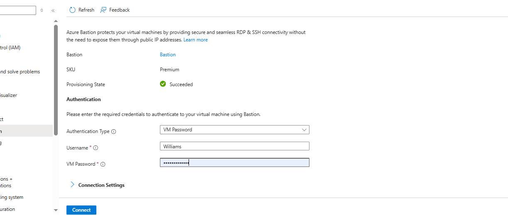


### Phase 3  Create the hub Network Security Group

1. In the Azure Portal search bar, type Network security groups.

2. Open the Network security groups service.

3. Select + Create.

4. On the Basics tab, configure it
5. Select Review + create.

6. Wait for validation to complete.

7. Select Create.

8. When deployment completes, select Go to resource.

The hub NSG has now been created. Next, configure its inbound rules.

### Configure inbound rules for the hub NSG

1 Open nimbus-hub-nsg.

2 Under Settings, select Inbound security rules.

3 Select + Add.

3 Configure the SSH rule as shown below.

4 Rule A — Allow SSH from Azure Bastion
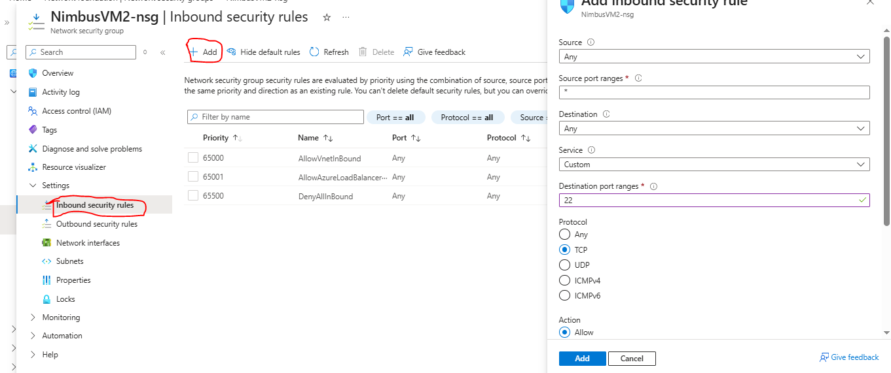

Why this rule is needed: SSH uses TCP port 22. Azure Bastion initiates the SSH connection to the target VM using its private IP address. Restricting the source to the Bastion subnet is safer than allowing SSH from every IP address.

If your NSG is associated with a subnet containing other VMs, consider narrowing the destination to the private IP of vm-hub-1 rather than using 
Repeat it again
### Rule B — Allow ICMP from the spoke subnet

Return to Inbound security rules.

Select + Add.
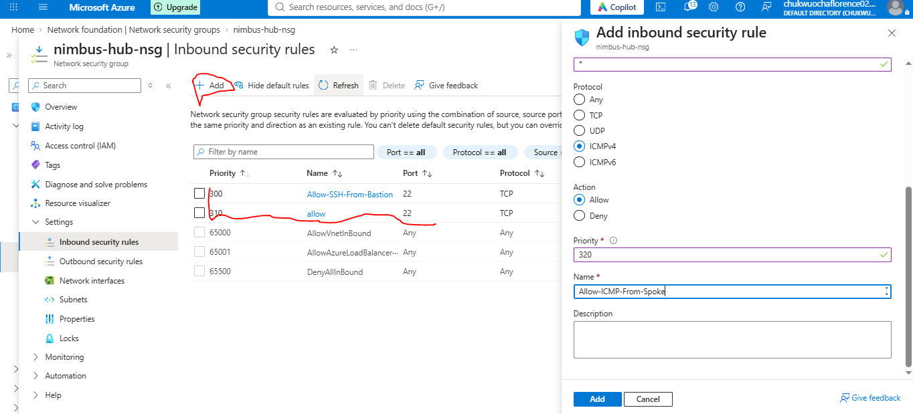

Why this rule is needed: The rule permits ping requests originating from the spoke subnet to reach resources protected by the hub NSG.

ICMP does not use TCP or UDP ports, so the destination port is not applicable to the protocol. If the portal requires a destination-port value, use *


 This rule allows ICMP requests from the hub subnet to reach the spoke VM.

 ###  Associate the NSGs with their respective subnets

Creating an NSG does not automatically apply it to a subnet. You must associate each NSG with the correct subnet.

#### Associate the hub NSG

1 Open the Azure Portal.

2 Search for Virtual networks.

3 Open the hub VNet.

4 Select Subnets.

5 Select nimbus-hub-subnet.

6 Locate the Network security group field.

7 Select nimbus-hub-nsg.

8 Select Save.

### Associate the spoke NSG

1 Open the spoke VNet.

2 Select Subnets.

3 Select nimbus-spoke-subnet.

4 Locate the Network security group field.

5 Select nimbus-spoke-nsg.

6 Select Save.

Verify the associations

Return to each VNet's Subnets page and confirm that:

- nimbus-hub-subnet uses nimbus-hub-nsg.

- nimbus-spoke-subnet uses nimbus-spoke-nsg.

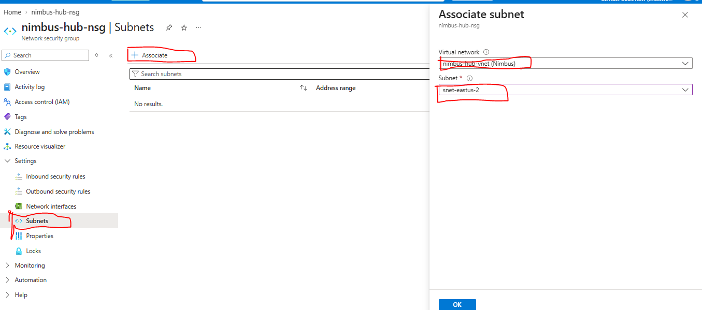


## Test Connectivity

Verify that the security policies are working seamlessly across your network topology.
1. Connect via Bastion:
   
	• Navigate to your virtual machine vm-hub-1 in the portal.
	• Click Connect \(\rightarrow \) Bastion.
	• Enter your VM credentials and log in. A secure browser terminal will open.
2. Ping the Second VM:
	• Inside your vm-hub-1 session, type the ping command followed by vm-hub-2

   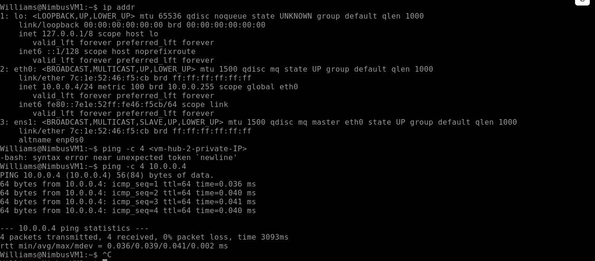 


   ### Phase 4 — Azure Key Vault Integration 


###  Create the Azure Key Vault

1. Log in to your Azure Portal.
2. Click the Create a Resource button (usually represented by a + icon on the top left or homepage).
3. Search for Key Vault in the marketplace search bar.
4. Select Key Vault from the results and click Create.

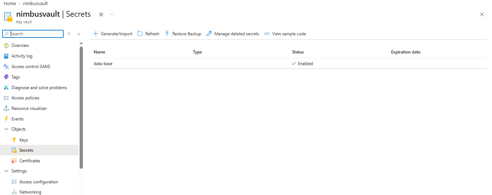

###   Create the Storage Account

 1. Search for Storage accounts.

2. Open the Storage accounts service.

3. Select + Create.
4. Select Review or Review + create.

5. Check the configuration.

6. Select Create.

7. Wait for deployment to complete.

Select Go to resource.


###  Create a private Blob container

A container organizes blobs, which are files stored in Azure Blob Storage.

- Open nimbusstorage.

- Under Data storage, select Containers.
- Click the add button and give it a name "Upload"
- Create

- Select + Container.
- Open uploads.

- Select Upload icon.

- Browse for the image

- Select Upload.
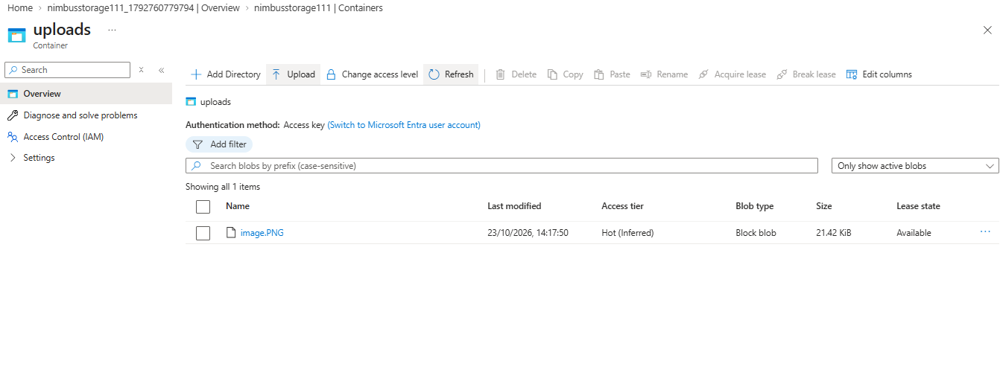


### Create a Public Endpoint

The private endpoint connects your Storage Account's Blob service to a private IP address in your VNet.

### Open Private Endpoints

1. Search the Azure Portal for Private endpoints.

2. Open the service.

3. Select + Create.
4. Configure the basic tab
5. Configure the Resource tab

   - Select Next: Resource.

   - Choose the option to connect to an Azure resource in your directory.

   - Select your subscription.

    - Set the resource type to Microsoft.Storage/storageAccounts.

    -  Select nimbusstorage, or your actual storage account name.

    - Under Target sub-resource, select blob.

N/B:  The private endpoint should be created in a VNet that can reach the VM you will use for testing.A private endpoint is not a replacement for the VM subnet's NSG. Review your existing network configuration before selecting a subnet, especially if you have enabled NSG or route-table policies for private endpoints.
   ###  Configure the Virtual Network tab

1. Select Next: Virtual Network.

2. Choose the existing hub VNet or another suitable VNet connected to the client VM.

3. Select the subnet in which the private endpoint will be placed.


    ### Configure DNS

- Select Next: DNS.

- Enable private DNS integration.

- Select or create the recommended private DNS zone:

privatelink.blob.core.windows.net

- Ensure the zone is linked to the VNet used by your testing VM, or to the appropriate connected network through your DNS design.

- Continue to Review + create.

- Review the settings.

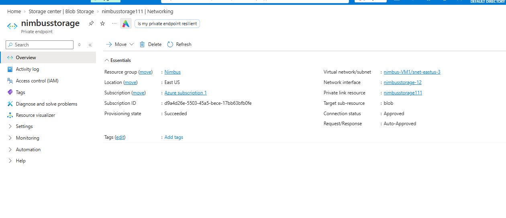


   ### Disable public network access

SecurityTips: After the private endpoint and DNS configuration are in place, disable the public network endpoint so that clients cannot access the storage account through its public endpoint.

###   Open the Networking settings

- Open your Storage Account.

- Under Security + networking, select Networking.

- Locate the Public network access setting.

- Select Disabled.

- Select Save
  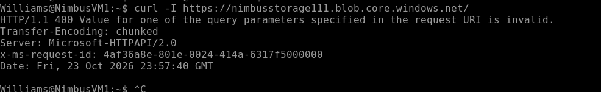
  
  ### Test access to the Blob service

  From a computer outside the Azure virtual network, with no VPN or private route into the VNet, run:


```
   nslookup nimbusstorage111.blob.core.windows.net
```
then:

```
  curl -I https://nimbusstorage111.blob.core.windows.net/
```  
